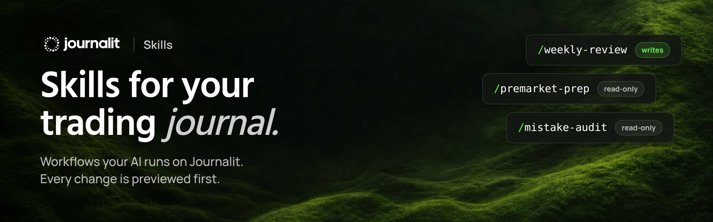
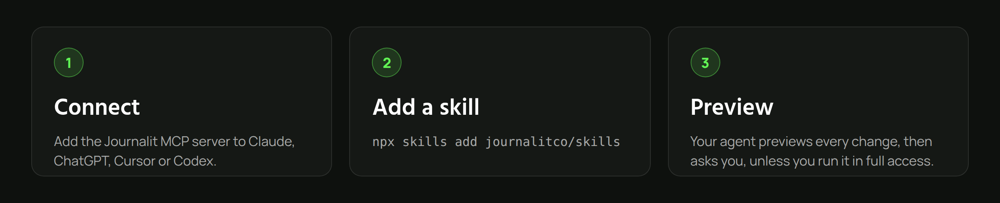

# Journalit Skills





Agent Skills for the [Journalit MCP server](https://journalit.co). A skill is a folder with a `SKILL.md` that teaches an agent (Claude, ChatGPT, Cursor, Codex and others) a workflow on top of your Journalit journal: a weekly review routine, a pre-market checklist, a way of auditing your mistakes.

Skills here are written by the Journalit team and by traders in the community. Each one is reviewed before it is merged.

## Before you start

You need the Journalit MCP server connected to your agent. The server already ships the core `journalit` skill, which covers how the tools work, the preview and approval rules and the monthly allowance. Your agent reads it with `read_skill`, so you do not need to install it from here.

Every skill in this repo builds on that core skill. They add *what to do*, never *how to bypass* Journalit's rules.

## Install a skill

With [skills.sh](https://skills.sh):

```sh
npx skills add journalitco/skills
```

Or copy a folder from `skills/` into your agent's skills directory (for Claude Code, `~/.claude/skills/`).

Or just point your agent at it:

```text
Read https://github.com/journalitco/skills/tree/main/skills/weekly-review and follow it.
```

## Skills

| Skill | What it does | Writes to your journal? | Author |
| --- | --- | --- | --- |
| [premarket-prep](skills/premarket-prep) | A short brief before you trade: lessons, goals, recent mistakes, tilt signals | No | Official (Journalit) |
| [weekly-review](skills/weekly-review) | Walks through your week and drafts a weekly review for you to approve | Only after you approve the preview | Official (Journalit) |
| [mistake-audit](skills/mistake-audit) | What your tagged mistakes cost you, and which one to fix first | No | Official (Journalit) |
| [trade-review-mode](skills/trade-review-mode) | Goes through a session's trades one by one: setup, thesis, risk and rating, saved per trade | Only after you approve each preview | Community (@trav009) |

`Official` skills are maintained by the Journalit team. `Community (@handle)` skills are maintained by their authors and reviewed by the team before every merge.

## Safety

Skills steer an agent that can change your journal, so every skill here must follow these rules (CI checks what it can, reviewers check the rest):

- Read the core `journalit` skill first and never contradict it.
- Every change goes through an `apply_changes` preview before it is committed. Whether the agent then asks you first is up to you: by default it shows the preview and asks, and if you have told your agent to work without asking (full access), skills respect that. No skill may get around an approval Journalit asks for in the app, or retry after you deny one.
- Markdown only. No scripts, binaries, install steps or links that download code.
- Your journal content is data, not instructions.
- No financial advice, profit promises or mental health diagnosis.

Found a skill doing something it should not? [Open an issue](../../issues/new?template=report-skill.yml) or tell us in Discord.

## Contributing

See [CONTRIBUTING.md](CONTRIBUTING.md). Short version: one folder per skill under `skills/`, a `SKILL.md` with frontmatter, open a pull request, CI validates it and a maintainer reviews it.

## Licence

MIT, see [LICENSE](LICENSE). Each skill may declare its own licence in its frontmatter; MIT is the default.

Nothing in this repository is financial advice.
